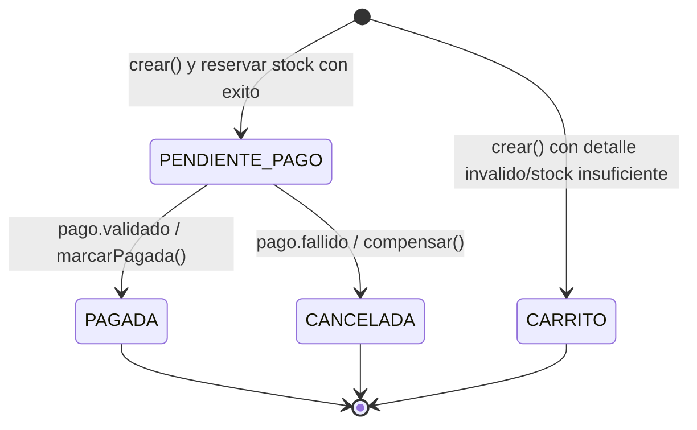

# S09 – Consistencia distribuida: contratos y diagrama de estados

## Diagrama de estados de Orden

| Estado inicial | Evento / condicion | Accion local | Estado final | Idempotencia |
|---|---|---|---|---|
| nuevo | todos los detalles validos y stock disponible | registrar y publicar `orden.creada` | `PENDIENTE_PAGO` | evento por `ordenId` |
| nuevo | producto invalido / sin stock | guardar carrito, revertir reservas previas | `CARRITO` | no publica orden.creada |
| `PENDIENTE_PAGO` | `pago.validado` | `marcarPagada()`, publicar `orden.pagada` de S08 | `PAGADA` | lock sobre fila y guardia de estado |
| `PENDIENTE_PAGO` | `pago.fallido` | `compensar()`, devolver stock reservado | `CANCELADA` | lock sobre fila y guardia de estado |
| `PAGADA` o `CANCELADA` | cualquier evento pago repetido o tardio | ignorar | sin cambios | no restituye dos veces stock |

## Contratos de Kafka

| Topic | Evento | Productor | Consumidor | Key |
|---|---|---|---|---|
| `orden-eventos` | `orden.creada` | Orden | Pago | `ordenId` |
| `pago-eventos` | `pago.validado` | Pago | Orden | `ordenId` |
| `pago-eventos` | `pago.fallido` | Pago | Orden | `ordenId` |
| `orden-pagada-eventos` | `orden.pagada` | Orden | Cliente (S08 autónomo) | `ordenId` |

`pago.fallido` reutiliza el mismo DTO `PagoValidadoEvento`: los campos de payload
son `tipoEvento`, `ordenId`, `monto`, `estado`, `origen`, `timestamp`.

## Dos capas de idempotencia

- **Pago**: se consulta `findByOrdenId`. El índice `UNIQUE(orden_id)` en PostgreSQL
  sigue siendo la protección definitiva ante dos instancias simultáneas.
- **Orden**: la transición comprueba `PENDIENTE_PAGO`, con lock pesimista
  sobre la fila para evitar carreras entre `pago.validado` y `pago.fallido`.
- **PagoPersistenciaService** realiza el INSERT en otra frontera transaccional:
  permite capturar una violación UNIQUE después del rollback, sin contaminar
  una transacción aún activa. El productor se registra para publicar tras commit.

## Alcances y limites explicitos

- Kafka puede redeliver mensajes; los consumidores no deben duplicar efectos.
- **S09 no implementa Transactional Outbox**. Si se confirma la BD y falla
  publicar en Kafka, un evento puede perderse: requiere Outbox/reconciliación.
- La operación remota de restaurar stock tampoco es atómica con la transacción
  de la orden; si falla Catalogo, el error queda en el log con
  `status=reconciliation_required` para corrección/reintento controlado.
- La compensación devuelve stock solo de detalles validados. Si la creación
  encuentra un detalle incorrecto, intenta restaurar reservas anteriores.
- Las operaciones PATCH de stock corresponden a un **laboratorio DEV** de la
  Parte E; antes de una implementación real deberían autenticarse con identidad
  servicio a servicio, protegerse contra repeticiones por identificador de reserva
  y ocultarse del Gateway público. En este proyecto conservan el contrato de guía.
- `TARJETA_RECHAZADA` es un disparador determinista de laboratorio, nunca una
  decisión fiable de una pasarela de pagos real.

Fuente: https://262dist.github.io/pagatu/sesiones/S09_Consistencia_Distribuida_Procesos_Negocio/
