# S01 - Construcción de un servicio base para un sistema distribuido

## 1. Microservicios correctamente delimitados según el dominio

El microservicio `orden-ms` gestiona la entidad **Orden** y su ciclo de vida: cliente asociado mediante identificador, concepto solicitado mediante identificador, cantidad, precio unitario, total, estado y fecha de creación. Estos datos pertenecen al dominio de órdenes porque describen una transacción y su estado; el servicio no administra categorías, productos ni el catálogo, responsabilidades que corresponden a `pagatu-catalogo-ms`.

Los campos `clienteId` y `conceptoId` se mantienen como referencias por identificador. De esta forma, `orden-ms` no necesita apropiarse de las tablas o responsabilidades de otros dominios y conserva una separación clara de responsabilidades.

## 2. Persistencia de datos con PostgreSQL y Flyway

La persistencia del servicio se implementó con **PostgreSQL 16** en Docker. En DEV, la aplicación Spring Boot se ejecuta en el host y se conecta a `pagatu_orden_db` mediante `localhost:15433`. La estructura se versiona con Flyway y Hibernate se mantiene en modo de validación (`ddl-auto: validate`).

### 2.1 Migración versionada

La migración `V1__create_ordenes.sql` crea la tabla `ordenes` y los índices necesarios.

<figure>
  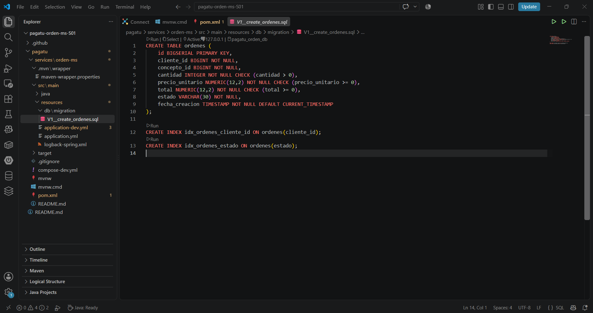
  <figcaption>Figura 1. Migración Flyway versionada para la creación de la tabla <code>ordenes</code>.</figcaption>
</figure>

### 2.2 Aplicación de Flyway y arranque

Durante el arranque se verificó que Flyway aplicó la versión 1 y que Spring Boot terminó de iniciar en el puerto `8080`.

<figure>
  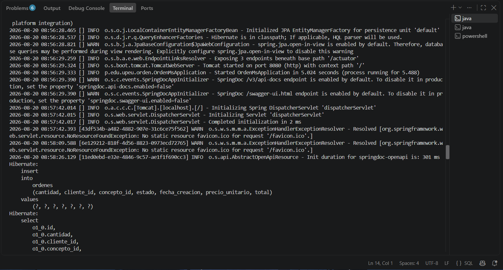
  <figcaption>Figura 2. Migración aplicada correctamente, conexión PostgreSQL y arranque de Tomcat en el puerto 8080.</figcaption>
</figure>

### 2.3 Verificación con `psql`

Se comprobó directamente desde el contenedor que existen `flyway_schema_history` y `ordenes`, y que la tabla contiene datos persistidos.

```powershell
docker exec -it pagatu-postgres-orden-dev psql -U pagatu -d pagatu_orden_db -c "\dt"
docker exec -it pagatu-postgres-orden-dev psql -U pagatu -d pagatu_orden_db -c "SELECT * FROM ordenes;"
```

<figure>
  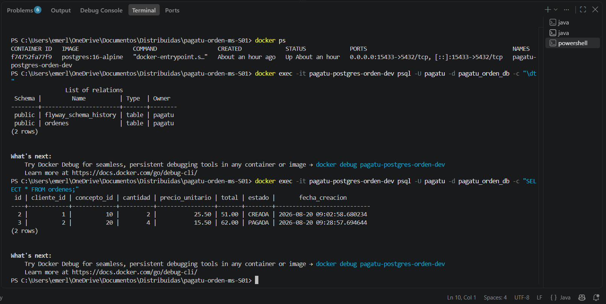
  <figcaption>Figura 3. Tablas y registros verificados mediante <code>psql</code> dentro del contenedor PostgreSQL.</figcaption>
</figure>

También se consultó el historial de Flyway para comprobar que la migración quedó registrada como exitosa.

<figure>
  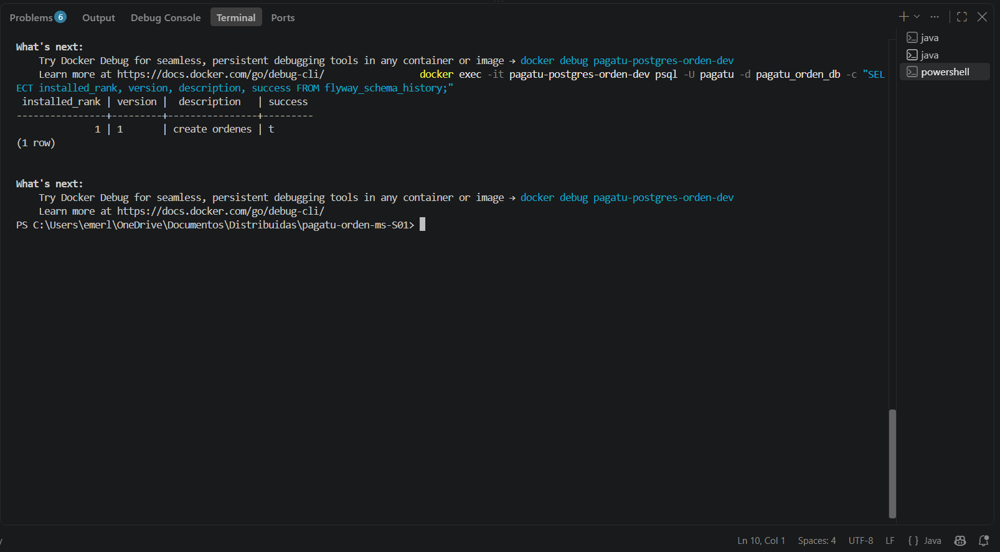
  <figcaption>Figura 4. Registro de la migración versión 1, <code>create ordenes</code>, con estado exitoso.</figcaption>
</figure>

## 3. Endpoints REST funcionales y documentados

El servicio se ejecutó en DEV con el Maven Wrapper del proyecto:

```powershell
.\mvnw.cmd spring-boot:run
```

El contrato REST se expone bajo `/api/v1/ordenes` y fue verificado tanto por Swagger como por PowerShell.

### 3.1 Swagger / OpenAPI

<figure>
  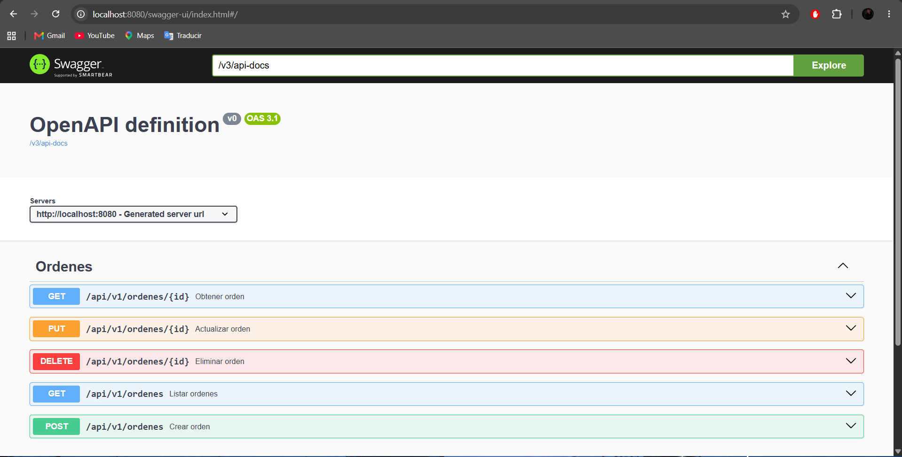
  <figcaption>Figura 5. Swagger muestra las operaciones GET, POST, PUT y DELETE del recurso <code>ordenes</code>.</figcaption>
</figure>

### 3.2 CRUD por PowerShell

**POST - creación.** Se creó una orden desde PowerShell y el servicio calculó el total de manera consistente.

<figure>
  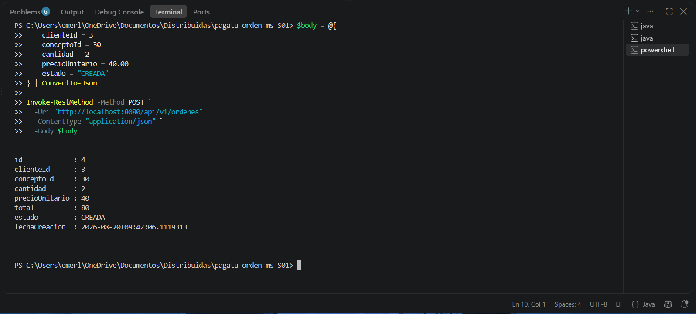
  <figcaption>Figura 6. Creación de una orden mediante petición POST desde PowerShell.</figcaption>
</figure>

**GET - lectura.** Se listaron las órdenes persistidas mediante el endpoint general.

<figure>
  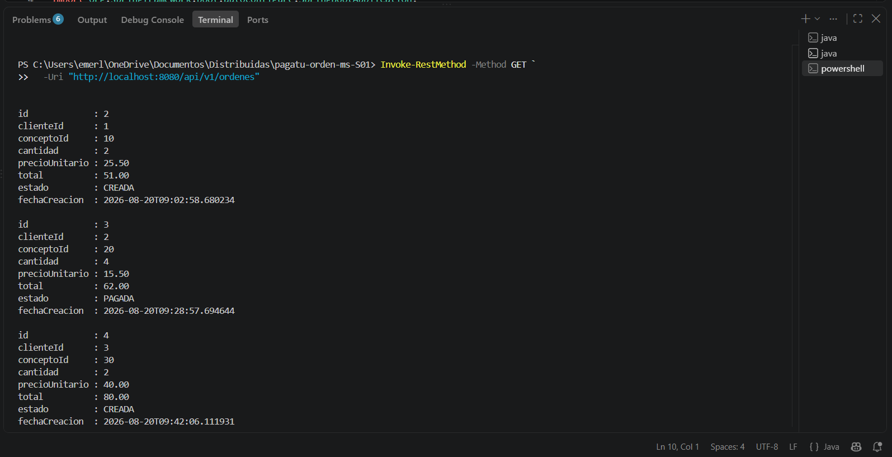
  <figcaption>Figura 7. Consulta de órdenes mediante petición GET desde PowerShell.</figcaption>
</figure>

**PUT - actualización.** Se modificó una orden existente y el total se recalculó a partir de la nueva cantidad.

<figure>
  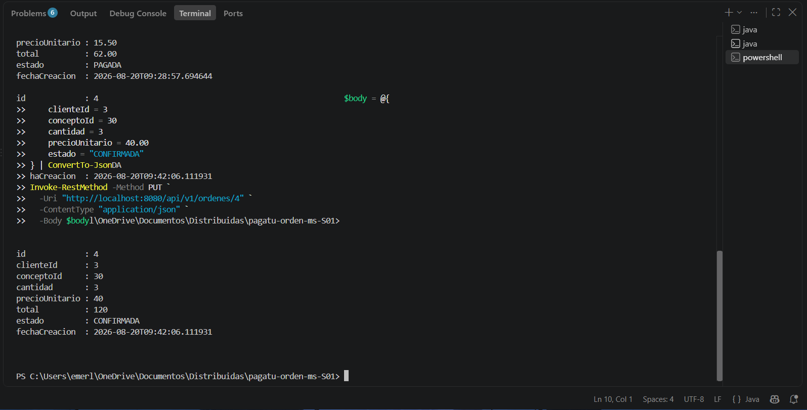
  <figcaption>Figura 8. Actualización de una orden mediante petición PUT desde PowerShell.</figcaption>
</figure>

**DELETE y 404.** Después de eliminar el recurso, una consulta posterior al mismo identificador devolvió `404 Not Found`, confirmando el manejo de recursos inexistentes.

<figure>
  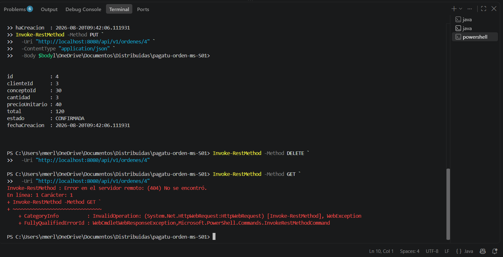
  <figcaption>Figura 9. Eliminación del recurso y comprobación posterior mediante HTTP 404.</figcaption>
</figure>

### 3.3 Validación HTTP 400

Se envió una orden con `cantidad = 0`. La validación rechazó la entrada y devolvió `400 Bad Request`, junto con el mensaje `cantidad: debe ser mayor que 0` y un `traceId` para trazabilidad.

<figure>
  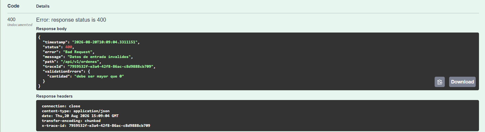
  <figcaption>Figura 10. Validación de datos de entrada mediante HTTP 400.</figcaption>
</figure>

## 4. Ejecución y escalamiento horizontal

Se ejecutaron dos instancias del mismo microservicio en paralelo. La primera utiliza el puerto `8080` y la segunda se inició con el argumento `--server.port=8081`. Ambas comparten la misma PostgreSQL DEV, pero cada proceso atiende peticiones de forma independiente.

| Aspecto | Instancia 1 | Instancia 2 |
| --- | --- | --- |
| Puerto | `8080` | `8081` |
| Ejecución | Maven Wrapper | Maven Wrapper + `--server.port=8081` |
| Base de datos | Misma PostgreSQL DEV | Misma PostgreSQL DEV |
| `/actuator/health` | `UP` | `UP` |

### 4.1 Health de ambas instancias

<figure>
  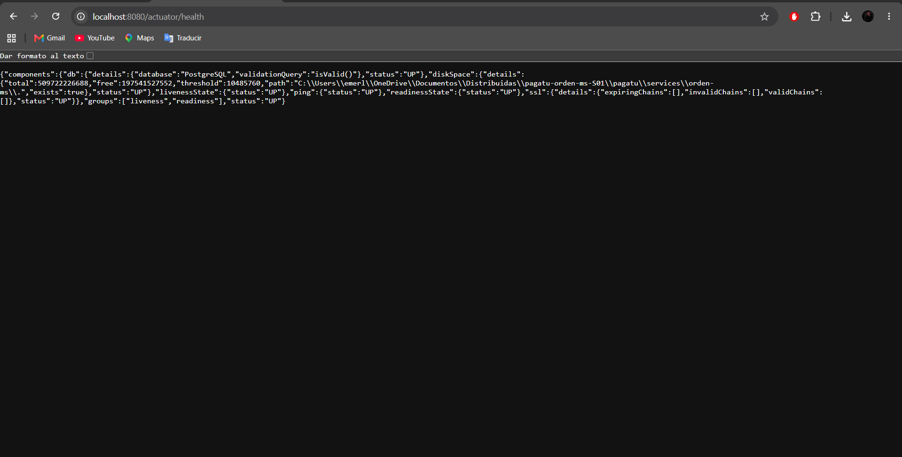
  <figcaption>Figura 11. Primera instancia: <code>localhost:8080/actuator/health</code> con estado <code>UP</code>.</figcaption>
</figure>

<figure>
  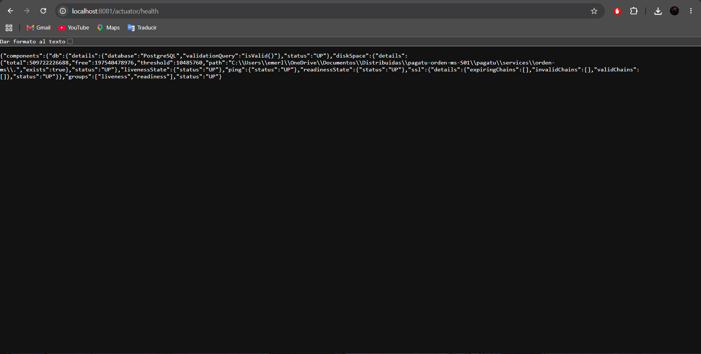
  <figcaption>Figura 12. Segunda instancia: <code>localhost:8081/actuator/health</code> con estado <code>UP</code>.</figcaption>
</figure>

### 4.2 Métricas

Actuator expuso métricas de HTTP, JVM, CPU, JDBC, HikariCP y Tomcat, entre otras.

<figure>
  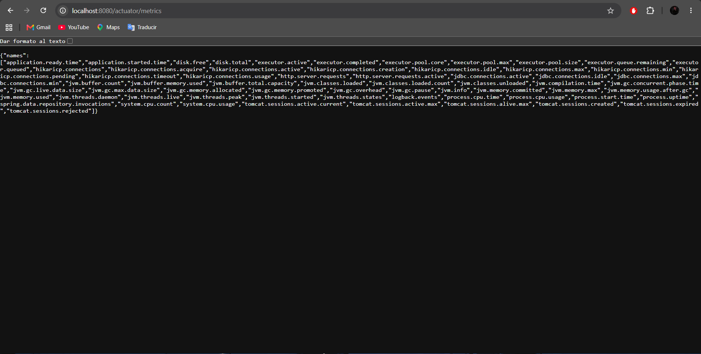
  <figcaption>Figura 13. Métricas disponibles mediante <code>/actuator/metrics</code>.</figcaption>
</figure>

Un microservicio no debe depender de un único puerto fijo porque el escalamiento horizontal implica crear varias instancias del mismo servicio. En DEV se usan puertos distintos para evitar colisiones; en una arquitectura distribuida real, un Gateway, balanceador o mecanismo de descubrimiento de servicios dirige el tráfico a las instancias disponibles sin que el consumidor tenga que conocer cada puerto individual.

## 5. Documentación técnica clara y reproducible

### 5.1 Requisitos

- Java 21 LTS.
- Docker Desktop.
- PowerShell o terminal equivalente.
- Maven Wrapper incluido en el proyecto.
- Navegador para Swagger y Actuator.

### 5.2 Levantar PostgreSQL DEV

Desde `pagatu/services/orden-ms`:

```powershell
docker compose -f compose-dev.yml up -d
docker ps
```

Configuración utilizada:

```text
Host: localhost
Puerto: 15433
Base de datos: pagatu_orden_db
Usuario: pagatu
```

### 5.3 Ejecutar la primera instancia

```powershell
$env:JAVA_HOME="C:\Program Files\Eclipse Adoptium\jdk-21.0.12.8-hotspot"
$env:Path="$env:JAVA_HOME\bin;$env:Path"
.\mvnw.cmd spring-boot:run
```

Verificaciones principales:

```text
http://localhost:8080/swagger-ui.html
http://localhost:8080/actuator/health
http://localhost:8080/actuator/metrics
```

### 5.4 Ejecutar la segunda instancia

En otra terminal:

```powershell
$env:JAVA_HOME="C:\Program Files\Eclipse Adoptium\jdk-21.0.12.8-hotspot"
$env:Path="$env:JAVA_HOME\bin;$env:Path"
.\mvnw.cmd spring-boot:run "-Dspring-boot.run.arguments=--server.port=8081"
```

Verificar:

```text
http://localhost:8081/actuator/health
```

### 5.5 Verificar PostgreSQL y Flyway

```powershell
docker exec -it pagatu-postgres-orden-dev psql -U pagatu -d pagatu_orden_db -c "\dt"
docker exec -it pagatu-postgres-orden-dev psql -U pagatu -d pagatu_orden_db -c "SELECT * FROM ordenes;"
docker exec -it pagatu-postgres-orden-dev psql -U pagatu -d pagatu_orden_db -c "SELECT installed_rank, version, description, success FROM flyway_schema_history;"
```

<div class="callout">
<strong>Repositorio:</strong> <a href="https://github.com/obedfernandez/pagatu-orden-ms-S01">https://github.com/obedfernandez/pagatu-orden-ms-S01</a><br>
La aplicación se ejecutó en DEV con Maven Wrapper y PostgreSQL en Docker. La ejecución de la aplicación dentro de Docker corresponde al apartado opcional de la sesión y no se incluyó en esta evidencia.
</div>

## Error o hallazgo técnico

En la primera ejecución, Spring Boot logró conectarse a PostgreSQL, pero Hibernate detuvo el arranque con el mensaje `Schema validation: missing table [ordenes]`. El log permitió descartar un problema de conexión, porque HikariCP había establecido correctamente la sesión con `pagatu_orden_db`.

El diagnóstico mostró que la migración `V1__create_ordenes.sql` existía, pero Flyway no estaba siendo auto-configurado correctamente con la configuración inicial de dependencias en Spring Boot 4. Se ajustó el `pom.xml` para utilizar `spring-boot-starter-flyway` junto con el soporte PostgreSQL. Al reiniciar, Flyway creó `flyway_schema_history`, aplicó la versión 1 y luego Hibernate pudo validar el esquema. El aprendizaje principal fue revisar el orden de los logs para distinguir entre errores de conexión, migración y validación JPA.

## Reflexión técnica breve

Un microservicio debe poder ejecutarse de forma reproducible para que su funcionamiento no dependa de la configuración particular de una computadora. En DEV, Maven Wrapper estandariza la forma de compilar y levantar la aplicación, mientras que la configuración por ambiente mantiene separadas las dependencias externas. En un entorno cercano a producción, la contenerización permite empaquetar de forma consistente la aplicación y sus requisitos. Además, el servicio debe ser stateless para que varias instancias puedan atender solicitudes sin depender de memoria local compartida. Al escalar horizontalmente, cada instancia puede usar un puerto o dirección diferente, por lo que el consumidor no debería acoplarse a uno específico. Un Gateway, balanceador o registro de servicios permite distribuir el tráfico y reemplazar instancias sin afectar al cliente. Esto mejora escalabilidad, disponibilidad y mantenibilidad del sistema distribuido.

<div class="feedback-page"></div>

# Anexo: Feedback de la sesión

**1. ¿Cuál es el aprendizaje más importante que te llevas de la clase de hoy?**  
Aprendí a construir y validar un microservicio Spring Boot con persistencia PostgreSQL, migraciones Flyway, CRUD REST, Swagger, Actuator y trazabilidad, además de comprobar que el mismo servicio puede ejecutarse en más de una instancia.

**2. ¿Qué punto de la clase te resultó más confuso o te dejó con dudas?**  
La parte más confusa fue diferenciar un error de conexión a PostgreSQL de un error en las migraciones. Los logs ayudaron a identificar que la conexión funcionaba y que el problema estaba en la ejecución de Flyway.

**3. ¿Tienes alguna pregunta que te gustaría que sea respondida la siguiente clase?**  
¿Cómo se incorporará un Gateway o un registro de servicios para que las distintas instancias puedan descubrirse y recibir tráfico automáticamente?

**4. Sobre tu nivel de comprensión de la clase de hoy:**  
**¡Entendido! - Lo domino y podría explicarlo.**

**5. ¿Cómo puedo ayudarte a comprender mejor el tema?**  
Continuar con ejercicios prácticos donde se integren los componentes del sistema distribuido y se analicen errores reales de configuración, red y persistencia.

**6. Autoevaluación de participación y esfuerzo:**  
**Muy Comprometido/a: Me esforcé al máximo.**

**7. Mi satisfacción con la clase fue:**  
**9/10.**
